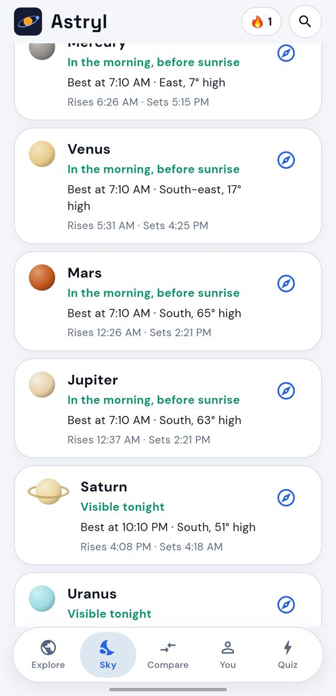
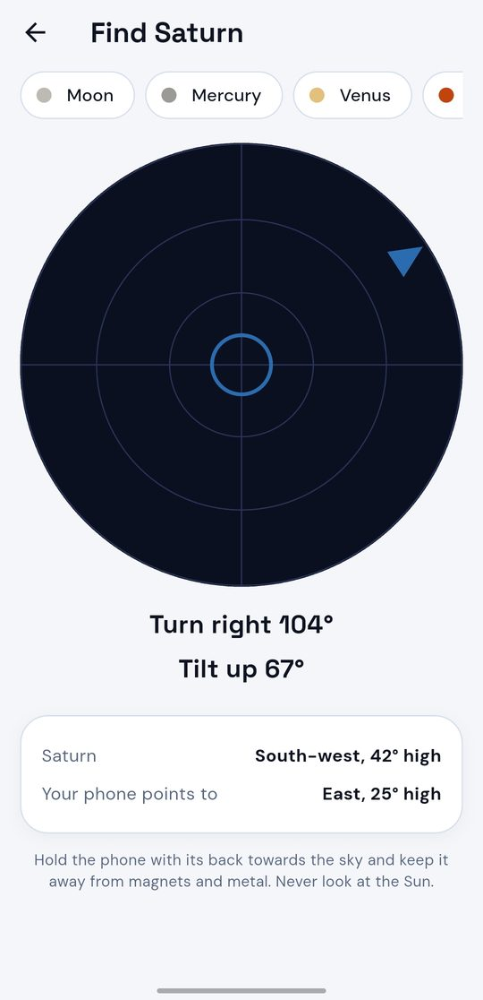
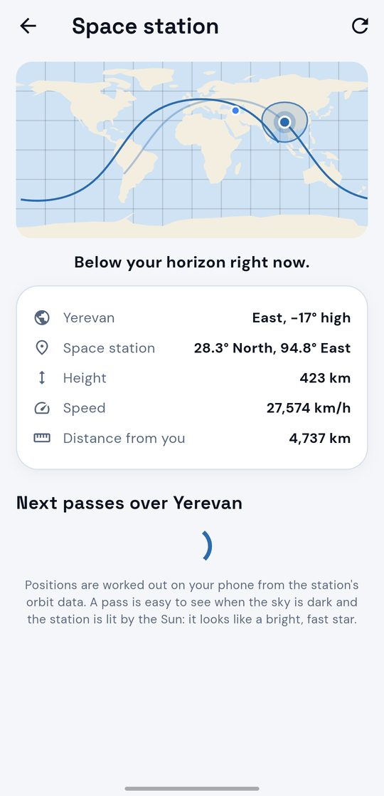
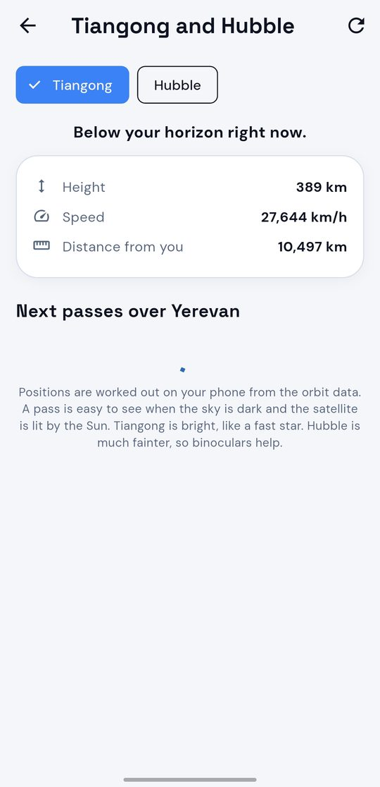
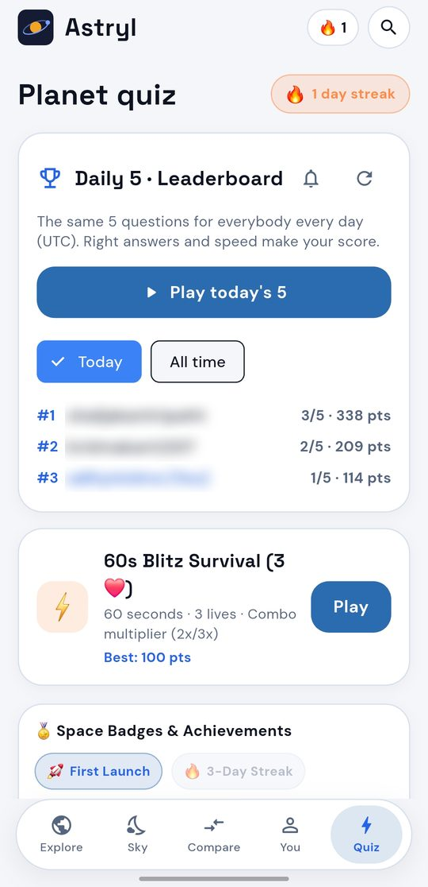
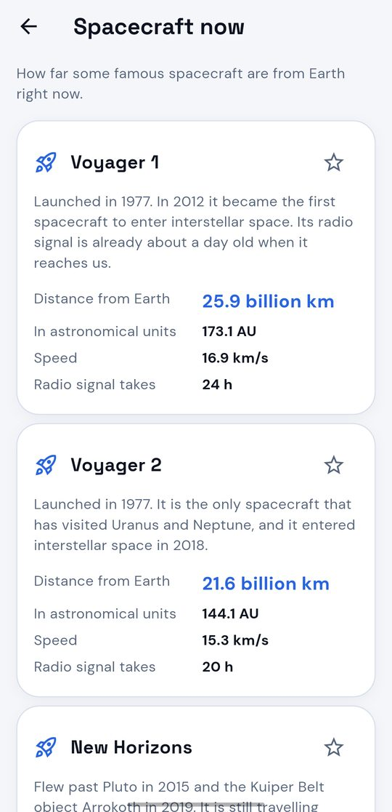
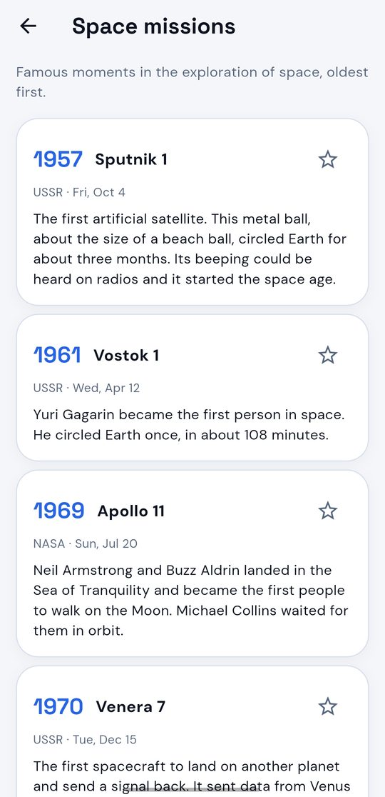
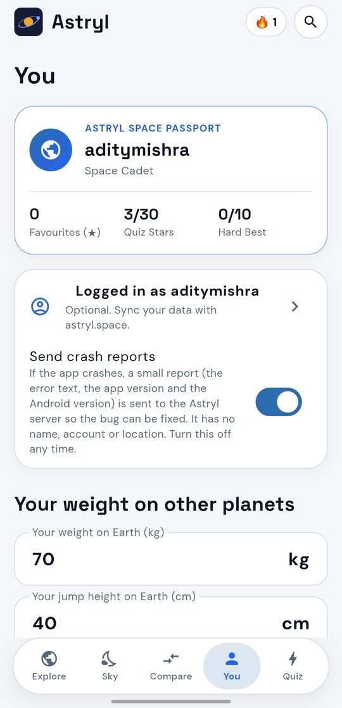

<div align="center">


# Astryl

**Know your space.**

Real planet positions, rotating 3D worlds, a star map for your sky,<br>
a daily space quiz, and an honest answer to "could humans live here?"

[](https://github.com/aditymishr098-collab/astryl/releases/latest)
[](https://github.com/aditymishr098-collab/astryl/releases)
[](https://github.com/aditymishr098-collab/astryl/actions/workflows/ci.yml)
[](https://astryl.space)
[](LICENSE)


[**⬇ Download the latest APK**](https://github.com/aditymishr098-collab/astryl/releases/latest) · [**🌐 Open astryl.space**](https://astryl.space)

[Website](https://astryl.space) · [Releases](https://github.com/aditymishr098-collab/astryl/releases) · [Changelog](CHANGELOG.md) · [Privacy](https://astryl.space/privacy.html) · [Report a problem](https://github.com/aditymishr098-collab/astryl/issues)

</div>

---

## Screenshots

<table>
  <tr>
    <td align="center"><br><sub><b>Explore in 3D</b><br>the Solar System</sub></td>
    <td align="center"><br><sub><b>Tonight's sky</b><br>Moon and sun times</sub></td>
    <td align="center"><br><sub><b>Planets tonight</b><br>when and where</sub></td>
    <td align="center"><br><sub><b>Star map</b><br>your own sky</sub></td>
    <td align="center"><br><sub><b>Find it</b><br>point your phone</sub></td>
  </tr>
  <tr>
    <td align="center"><br><sub><b>Space station</b><br>live map and passes</sub></td>
    <td align="center"><br><sub><b>Tiangong and Hubble</b><br>passes over you</sub></td>
    <td align="center"><br><sub><b>Compare</b><br>two worlds</sub></td>
    <td align="center"><br><sub><b>Daily 5</b><br>streak and board</sub></td>
  </tr>
  <tr>
    <td align="center"><br><sub><b>Spacecraft now</b><br>how far is Voyager</sub></td>
    <td align="center"><br><sub><b>Space news</b><br>live headlines</sub></td>
    <td align="center"><br><sub><b>Missions</b><br>Sputnik to today</sub></td>
    <td align="center"><br><sub><b>You</b><br>account and settings</sub></td>
  </tr>
</table>

## Why Astryl

| | |
|---|---|
| 🔭 **Real sky, real maths** | Planet positions, the Moon, the moons of Jupiter and Saturn, sunrise and sunset, eclipses and the star map are all calculated on your phone, not copied from a website. |
| 🎯 **A reason to come back** | The Daily 5 quiz: the same five questions for everybody each day, a streak, badges and a leaderboard. |
| 🔒 **Private** | No ads, no trackers. An account is only a username and a password, no e-mail. Nothing else is sent unless you agree. |
| 🌍 **English and हिन्दी** | The whole app and the website are in English and Hindi, or follow your phone. |
| 🌐 **App and website together** | The same data and the same account work in the app and on [astryl.space](https://astryl.space). |
| 🆓 **Open source** | AGPL-3.0. Read it, change it, build it yourself; if you share a changed version, share its source too. |

## Features

### 🪐 Explore
- **Eyes on the Solar System.** All the planets in one 3D scene at their real directions from the Sun, with colour-coded orbits. Drag to look around, pinch to zoom, tap a planet to fly to it. Pick any date from 1800 to 2050, step through time, or press play and watch the planets move.
- **3D worlds.** Rotate and zoom every body with your finger: Earth with moving clouds, city lights and aurora, Jupiter's Great Red Spot, Saturn's rings, the glowing Sun and the cracked ice of Europa.
- **18 worlds.** The Sun, all 8 planets, Pluto, our Moon and 7 famous moons: Io, Europa, Ganymede, Callisto, Titan, Enceladus and Triton.
- **Real moons of Jupiter and Saturn.** On the planet page, the four big moons of Jupiter and eight of Saturn are drawn where they really are, for any date, with buttons to step in time and a play mode. The formulas are Jean Meeus' (see [How it works](#how-it-works)).
- **Interior cutaway.** Tap the layers of any planet, moon or the Sun (crust, mantle, core, ocean, metallic hydrogen) to see what is inside.
- **Telescope simulator.** See how a world looks to the naked eye, through binoculars (10×) and a telescope (100×), including Jupiter's moons and Saturn's rings.

### 🌙 Tonight's sky
- **Planets tonight (its own page).** Pick your city (no location permission needed) and Astryl tells you which planets are up after dark, the best time to look, the direction and how high, plus rise and set times.
- **The Moon tonight.** Phase, how much of it is lit, moonrise and moonset, and the dates of the next full and new moon.
- **The sky on any date.** Step a day back or forward, or pick any date from 1900 to 2049.
- **Moon calendar.** A month of Moon phases with the dates and times of the main phases. Tap a day for its phase, moonrise and moonset.
- **Sun and light.** First light, sunrise, golden hours, solar noon, sunset, last light, when the sky is fully dark, and the length of the day.
- **Star map.** The sky above your city with 1,000 stars, 89 constellations, the Moon, the Sun and the planets. Drag, pinch, tap a star or a constellation for its name, brightness and where it is right now. Step the time an hour at a time.
- **Constellation stories.** Short stories for eleven famous constellations, with how to find them. Kept in the app, so the star map works offline.
- **Binocular guide.** Twelve sights for ordinary binoculars (the Pleiades, the Orion Nebula, the Andromeda Galaxy and more), with where each one is tonight and when.
- **Space events.** The next 12 months of full and new moons, planet oppositions, the best evenings and mornings for Mercury and Venus, close meetings of planets, equinoxes and solstices, meteor showers, and total, annular, hybrid and partial **eclipses**. A bell on every event reminds you the evening before, made on your phone with no internet.
- **Daily sky note (optional).** A short evening note with the Moon's phase and the planets to look for, worked out on your phone, at a time you choose.
- **Space station, Tiangong and Hubble.** Where each one is right now on a map, when it passes over your city and whether you can see it, with a bell for every pass.
- **Rocket launches.** The upcoming launches, inside the events calendar.
- **Space news.** The latest space headlines from the [Spaceflight News API](https://spaceflightnewsapi.net). Only text is downloaded; a story opens on the publisher's own site.
- **Spacecraft now.** How far Voyager 1 and 2, New Horizons, the James Webb telescope, ISRO's Aditya-L1, the space station, Hubble and the Mars rovers are from Earth right now, and how long a radio signal needs to reach them.
- **Find it with your compass.** Tap the compass next to the Moon or a planet, hold your phone up, and Astryl shows which way to turn and tilt until you point right at it. It uses motion sensors only: no camera, no location.
- **Share tonight's sky.** One tap makes a picture of the Moon and the planets you can see from your city tonight.
- **Moon phase widget.** A home-screen widget shows tonight's Moon phase and how much of it is lit (English or Hindi), and a tap opens Astryl. It is worked out from the date alone, so it needs no internet and sends nothing.

### 🎯 Quiz and Daily 5
- **Daily 5.** The same five questions for everybody every day (UTC). Right answers and speed make your score. The server picks the questions and checks your answers and your time, so nobody can post a made-up score.
- **Leaderboard.** *Today*, *This week* and *All time* boards, and your own rank. A switch in Account (on by default) lets you hide yourself from the board.
- **Streaks.** Your streak (days in a row that ends today or yesterday) and your best streak.
- **Seven badges.** First run, 3, 7 and 30 days in a row, a perfect 5 of 5, 10 runs and 50 runs.
- **Share your result.** One tap makes a score picture to send to friends, or copy it as text.
- **Daily reminder (optional).** A notification with a teaser of the first question and your streak, at a time you choose.
- **Level quiz.** Easy, Medium and Hard, 10 questions each, with a short "Why?" after each answer, a 50:50 and a hint. Your best score for each level is saved.
- **60 seconds Blitz.** Three lives, a combo multiplier (2× and 3×) and a best score.
- **Space badges.** Achievements for streaks, quiz stars and more.

### 🌍 Learn
- **Planet facts.** Diameter, gravity, temperature, length of day and year, moons, distance from the Sun and surface pressure.
- **Atmosphere and oxygen.** What each atmosphere is made of, and how its oxygen compares with Earth's.
- **Could humans live here?** A simple 0 to 10 life score for every world, from temperature, air pressure, oxygen, water, surface and gravity. Earth scores 10, Mars 4, Jupiter 0.
- **How far is it?** Today's real distance from Earth, and how long light, a spacecraft or a car would need to get there.
- **Compare.** Any two worlds side by side, with their true sizes drawn next to each other.
- **Did you know?** Short facts about every world, and a fact of the day.
- **Space missions.** A timeline of 15 famous missions from Sputnik 1 to Chandrayaan-3.
- **Surface maps of the Moon and Mars.** Pinch to zoom, tap a marker for the story, coordinates and who sent it: 15 landing sites on the Moon (Luna 9, Apollo 11 to 17, Chang'e, Chandrayaan-3, SLIM and more) and 10 on Mars (Viking, Sojourner, Spirit, Opportunity, Phoenix, Curiosity, InSight, Perseverance, Zhurong). The map is drawn, not a photo, and every site is at its real latitude and longitude.

### 🙋 You
- **Space Passport.** Your rank, favourites, quiz stars, and a live cosmic odometer: how far you have travelled around the Sun and the Galaxy since you were born.
- **Your weight and your jump** on every world, and **your age on other planets** with the date of your next birthday there.
- **My birthday sky.** The Moon's phase and where the planets were on the day you were born, how old you are in days, and the dates of your 10,000th day and your 1 billionth second.
- **Search and favourites.** Search planets, moons, missions and spacecraft in your language or in English. Star anything to keep it in your favourites.
- **Share.** Turn a planet's card into a picture and send it to friends.

### ⚙️ Made for everyone
- **One account, no e-mail.** The app opens on a page to make an account or log in (a username and a password, and a recovery code for a forgotten password). Your favourites, quiz scores, language, theme, city and birth date then follow you between the app and the website. You can log out, or delete the account and everything stored for it, any time. The website can be used without an account.
- **Use my location (optional).** One tap in the city list uses your approximate location for the sky above you. Android asks first.
- **Backup and restore.** Save your favourites, settings, scores, city and birth date in one small file and restore it on another phone. It goes nowhere unless you send it.
- **Light, dark or system theme**, and a **text size** setting (Normal, Large, Larger).
- **English and हिन्दी**, or your phone's language. Planet and constellation names are translated too.
- **Tablets and landscape.** A side rail and a wider layout on big screens.
- **In-app updates.** Each time the app opens it checks GitHub for a newer release and offers it, with a progress bar and the Android installer.

## 🌐 The website

[**astryl.space**](https://astryl.space) is the same Astryl in your browser, with the same account, in English and Hindi, dark by default.

- **Planets and 18 world pages** with facts, a 3D look, the interior, and for **Jupiter and Saturn their moons at their real positions** on any date.
- **Solar system, Compare, You** (weight, jump and age), **Constellations**, **Surface maps**, **Space missions** and **Spacecraft now**.
- **Tonight's sky**: the Moon, a calendar, the planets you can see tonight, and meteor showers.
- **Daily 5 and the leaderboard**, with streaks, badges, a This week board and a share-as-picture button.
- **Account first.** *Log in* and *Sign up* sit at the top of every page (they show your name once you are in), and a first visit opens a welcome page with the account form and a *Continue without account* button. The account is the same as in the app.
- **Download page** (linked from the footer) with the newest version, its date and size, the **SHA-256** of the APK, what is new, and how many times Astryl has been downloaded.
- **Link previews.** Every page has its own preview picture and structured data, so a shared link looks good in chats and search.
- Hosted free on **GitHub Pages**; the pages are built from the app's own data by `tools/build_site.py`.

## Install

1. Open the [latest release](https://github.com/aditymishr098-collab/astryl/releases/latest) on your Android phone.
2. Download the file `Astryl-vX.Y.Z.apk`.
3. Open it and allow your browser to install apps if Android asks.

To check the file, compare its SHA-256 with the one on [astryl.space/get.html](https://astryl.space/get.html) or on the release page. After that, Astryl updates itself: each time the app opens it checks GitHub for a newer release.

If you have a version older than 1.17.5, the app id changed (see the 1.17.5 line in the [changelog](CHANGELOG.md)): it installs as a new app and you move your data with Backup and Restore.

## Privacy

[Astryl](https://astryl.space): **no ads, and no e-mail address.** The full policy is at [astryl.space/privacy.html](https://astryl.space/privacy.html).

- Planet data, positions and 3D surfaces are calculated on your phone. Astryl is an online app: the first start needs internet to make an account or log in, and it also uses the internet for the update check, crash reports, sync and the live features below. After that, without internet it shows the last data it has.
- **Live features.** Astryl contacts `api.wheretheiss.at` (or `celestrak.org`) for the station's orbit data, `celestrak.org` for Tiangong and Hubble, `ll.thespacedevs.com` (Launch Library 2) for the launch list, and `api.spaceflightnewsapi.net` for the news. Nothing about you is sent; those services can only see your phone's internet address. Orbit data is saved on the phone, so the station keeps working for days without internet.
- **The account.** The app needs one (the website does not). A small server on [Supabase](https://supabase.com) stores your username, a hash of your password and of your recovery code, the date you accepted the privacy policy, your Daily 5 runs, and, if you keep sync on, your favourites, quiz scores, language, theme, city and birth date. Nothing is stored for a website visitor who has no account. Delete the account in the You tab and everything is removed.
- **Switches in your account.** *Show me on the leaderboard* is on (turn it off to hide your name). *Count me as an active user* (a random number made on your phone, not linked to you) and *share my country* (from your phone's language and region) are off until you turn them on. *Share my approximate location* is on if you allow Android's location permission when you make an account: only your latest place is kept, rounded to about 10 km, in the project's Supabase, updated when you open the app, and deleted when you switch it off. There is no background location.
- **The leaderboard** shows only your username, and only if you leave *Show me on the leaderboard* on.
- **Update check:** each time the app opens, it asks GitHub for the newest release. When you tap *Update now*, it downloads the signed APK from that release. Android only installs it if it is signed with the same key as the app you already have.
- **Crash reports** (on by default, switch in the You tab): one small report (the error text, the technical trace, the app version, the Android version string and the app language) goes to the project's own Supabase, kept 90 days, only to fix bugs. It has no name, account, device id or location.
- Your birth date and settings are kept on your phone. Android's cloud backup is switched off for Astryl; the backup file is made only when you ask.

### Security

- **Locked tables.** Every table in Supabase has row-level security on and no policy, so the public key inside the app and the website can read and write nothing by itself. The only door is one Edge Function, `account`. The service key stays inside Supabase and must never be put in the app, the website or this repository.
- **Rate limits.** Sign-up, login and recovery are limited per address and per account, and repeated wrong recovery codes lock that account for a while.
- **Server-checked quiz.** The Daily 5 questions, answers and timing live on the server; the app sends only the options you picked.
- **Nightly encrypted backup.** A GitHub Action saves the profiles, recovery hashes, synced data and Daily 5 runs, encrypts them (AES-256, key from a passphrase only the owner knows) and keeps the file for 30 days. Passwords themselves are in Supabase Auth and are not in it. See [docs/BACKUP.md](docs/BACKUP.md).
- **Signed releases.** The APK is built and signed by GitHub Actions from a version tag, and its SHA-256 is published with the release.

More in [supabase/README.md](supabase/README.md).

## How it works

| Part | How |
|---|---|
| Real positions and distances | Keplerian orbital elements from JPL ([Standish](https://ssd.jpl.nasa.gov/planets/approx_pos.html)), valid 1800–2050, solved on the phone. Checked against the 2025 Mars and Saturn and the 2026 Jupiter oppositions. |
| Moons of Jupiter and Saturn | Jean Meeus, *Astronomical Algorithms*: chapter 44 (the four big moons of Jupiter) and chapter 46 (eight moons of Saturn), with the ring tilt of chapter 45. Positions come out in planet radii as seen from Earth. They agree with the high-accuracy theory to about 0.1 radius for Jupiter and 0.2 for Saturn, plenty for a picture. The same code runs in the app (`lib/core/moons.dart`) and on the website (`tools/site_src/moons.js`), and the app's tests use numbers made by the website's code. |
| 3D globes | A single fragment shader (`shaders/planet.frag`) draws every surface from noise, so the app ships with no image files. |
| Tonight's sky | Rise, set and best viewing time from the same orbits plus the Moon from Paul Schlyter's method, all on the phone. Checked against London's sunrise on 21 June 2025 and the full and new moons of October 2025 and January 2026. |
| Sun and light | The Sun's height is calculated every 2 minutes over the solar day of your city and each crossing is found by interpolation: -0.833° for sunrise and sunset, 6° for the golden hours, -6° for first and last light, -18° for the fully dark sky. Good to about 3 minutes. |
| Moon calendar | The Moon's phase on each day is taken at noon. The four main phases are found by searching for the moment the Sun to Moon angle reaches 0, 90, 180 or 270 degrees, good to about an hour. |
| Space events | The same orbits and Moon maths find oppositions, greatest elongations, planet pairs closer than 2°, equinoxes and solstices. Checked against 2025–2026: Mars (16 Jan 2025), Saturn (21 Sep 2025) and Jupiter (10 Jan 2026) oppositions, Venus at 47° on 10 Jan 2025 and 15 Aug 2026, and the 2026 equinoxes and solstices within 15 minutes. Meteor shower peaks are typical yearly dates. |
| Eclipses | The Moon's position (Schlyter's method plus its distance) and the Sun's position decide when the Moon passes in front of the Sun or into Earth's shadow. Compared with the official lists for 2022 to 2029: all the main eclipses are found with the right type, times within a few minutes. Very faint penumbral eclipses are left out. The local estimate for a solar eclipse is rough (about 6% of the Sun's width). |
| Space station, Tiangong and Hubble | The orbit data (a TLE) is downloaded once and the position is computed on the phone with SGP4 (`lib/core/sgp4.dart`), checked against Vallado's published test vectors. A pass counts as easy to see when the Sun is more than 6° below the horizon and the satellite is still lit by the Sun. Hubble is only about magnitude 2 to 3 at its best, so it is hard to see. |
| Rocket launches | The list comes from [Launch Library 2](https://thespacedevs.com/llapi). Times are "no earlier than" and change often, so the list is refreshed at most every 3 hours. |
| Star map | About 1,000 stars (down to magnitude 4.6), the constellation lines and 12 binocular targets come from the [d3-celestial](https://github.com/ofrohn/d3-celestial) data (Hipparcos-based, BSD 3-clause). Positions are for the year 2000, so Astryl turns them to today's equinox with the IAU 1976 precession before drawing them with the Sun, Moon and planets, using a stereographic projection. Polaris stands at your latitude (within 1°). Names of stars stay in English; constellation names are translated into Hindi. |
| Compass finder | The phone's rotation sensor gives where the back of the phone points; Android's magnetic-declination model turns magnetic north into true north. The target comes from the same orbit maths as Tonight's sky. |
| Spacecraft distances | Voyager 1 and 2 are placed from NASA's one-light-day dates and New Horizons from its 50 AU date, then moved at their average speeds in a straight line: good to about 1%. The Mars rovers use the same orbit maths as the planet pages; the station, Hubble and JWST use fixed typical values. |
| Daily 5 | The questions are made by the Edge Function from a fixed seed for each UTC day, so they are never stored. A run is one row per person per day: the server notes when it started, then finishes it once and works out the score itself from the correct answers and the time. Streaks, badges and the weekly board are counted by one SQL function (`astryl_board`). |
| Quiz and facts | Most answers are worked out from the same data as the planet pages, so they stay right when the data changes. The "Did you know?" facts are written by hand from NASA sources. |
| Reminders and alerts | Event bells and the daily sky note are Android alarms set on the phone (up to 15 ahead), each with text worked out on the phone. They are set again each time the app opens and after a restart or update. |
| Moon phase widget | An Android home-screen widget (`MoonWidget.kt`) that works out the phase from the date and refreshes about every 30 minutes. |
| Life score | Six simple rules in `lib/core/habitability.dart`. A teaching aid, not science. |
| Planet facts | [NASA Planetary Fact Sheet](https://nssdc.gsfc.nasa.gov/planetary/factsheet/). Moon counts are NASA's known moons as of mid 2026. |

## Project layout

```
lib/                 the Flutter app
  core/              the maths: orbits, moons, sky, eclipses, SGP4, quiz, badges
  data/              planets, cities, star catalogue, account, sync, updates
  screens/           every screen        widgets/   shared widgets
  l10n/              English and Hindi texts (app_en.arb, app_hi.arb)
shaders/             planet.frag, the 3D surfaces
android/             Android project, including the Moon phase widget
site/                the website, built into plain files (do not edit by hand)
tools/               build_site.py and its sources in site_src/
supabase/            migrations, the account and backup Edge Functions
test/                unit tests (orbits, moons, badges, Daily 5, accounts, maps)
docs/                screenshots and BACKUP.md
.github/workflows/   CI, release, website, backup, keep-alive
```

## Build from source

```
flutter pub get
flutter gen-l10n
flutter analyze
flutter test
flutter build apk --release
```

The website is built with `python3 tools/build_site.py` (it needs Pillow for the link-preview pictures).

| Workflow | What it does |
|---|---|
| `ci.yml` | On every push and pull request: gen-l10n, analyze and tests. |
| `android-check.yml` | Builds a debug APK when the Android part or `pubspec.yaml` changes. |
| `release.yml` | When a tag such as `v1.35.0` is pushed: builds, signs and attaches the APK to the release. |
| `pages.yml` | Publishes the `site/` folder to GitHub Pages. |
| `backup.yml` | Nightly encrypted backup of the online data. |
| `keepalive.yml` | Keeps the free Supabase project awake. |

## Latest changes

| Version | What's new |
|---|---|
| **1.38.0** | **Universe map.** A new page in Sky: one 3D space you can turn and zoom, from the planets where they are right now, past nearby stars and the Milky Way, out to 3,600 real galaxies and the edge of the observable universe. 62 black holes are on it, from Gaia BH1 to M87* and TON 618; zoom in on one to see the real size of its horizon. Tap anything to read its distance, size or mass, or fly to it; search by name. Time can be sped up to watch planets orbit and the Milky Way turn (clearly marked as sped up). Works offline. Galaxy data: OpenNGC (CC BY-SA 4.0); far distances are estimates from redshift. |
| **1.37.0** | **News and a daily fact.** The Astryl team can now send a short note to every phone: the app asks the project's Supabase "anything new?" about every six hours and shows each new note as a notification (switch it off in Settings; only that question is sent). A daily "Did you know?" notification shows the fact of the day at a time you choose (it is turned on when you make an account and can be changed in Settings). On astryl.space, a notice can show the same notes, ask once for your approximate place (optional), and visitors are now counted without keeping any IP address. |
| **1.36.0** | **Profile photo, tidier Quiz.** Pick a photo for your profile: tap the round picture on your Space Passport (or use the account page on the website). It is cut to a small square on your phone, kept in the project's Supabase and shown only to you, not on the leaderboard. Remove it any time; deleting the account deletes it too. The Quiz tab is calmer: a slim Daily 5 card (Play, your streak and today's rank), the Leaderboard and My badges on their own pages, and Easy, Medium, Hard and 60s Blitz as four matching practice rows. |
| **1.35.3** | **Simpler sign-up, Planets tonight page.** Making an account now asks only for a username, a password and a tick for the privacy policy. When the recovery code is saved, Android is asked for the location (it sets your city and keeps your approximate place, rounded to about 10 km, in the project's Supabase; switch it off in your account) and for notifications (the daily sky note). Saying no is fine. In Sky, "Planets tonight" is its own page, like Space events. The website sign-up form is as simple. |

Every version since 1.0.0 is in the [**changelog**](CHANGELOG.md).

## Credits

- Planet facts: [NASA](https://nssdc.gsfc.nasa.gov/planetary/factsheet/). Orbits: [JPL](https://ssd.jpl.nasa.gov/planets/approx_pos.html). Moons of Jupiter and Saturn: Jean Meeus, *Astronomical Algorithms*, ported with the help of the MIT-licensed [astronomia](https://github.com/commenthol/astronomia) library for checking.
- Moon and Sun positions: Paul Schlyter's method. Satellites: SGP4 as published by David Vallado and CelesTrak orbit data.
- Stars, constellation lines and the Messier objects: [d3-celestial](https://github.com/ofrohn/d3-celestial) by Olaf Frohn (BSD 3-clause, copy in `assets/licenses`), built on the Hipparcos catalogue.
- Galaxies on the Universe map: [OpenNGC](https://github.com/mattiaverga/OpenNGC) by Mattia Verga and contributors (CC BY-SA 4.0). Distances are added by `tools/build_universe.py` (measured ones for nearby galaxies, estimates from redshift for the rest). The data file `lib/data/universe_catalog.dart` is shared under the same CC BY-SA 4.0 licence.
- Live data: [Spaceflight News API](https://spaceflightnewsapi.net), [Launch Library 2](https://thespacedevs.com/llapi), [Where the ISS at?](https://wheretheiss.at) and [CelesTrak](https://celestrak.org).
- Fonts: [Space Grotesk](https://fonts.google.com/specimen/Space+Grotesk) for titles and [DM Sans](https://fonts.google.com/specimen/DM+Sans) for text, both under the SIL Open Font License (`assets/fonts/OFL-*.txt`) and kept inside the app. Devanagari uses the phone's own font.

## Contributing

Bugs and ideas are welcome in the [issues](https://github.com/aditymishr098-collab/astryl/issues). Found a wrong word? All texts live in `lib/l10n/app_en.arb` and `lib/l10n/app_hi.arb`: edit the matching file and open a pull request. Help from native Hindi speakers is very welcome. Before a pull request, run `flutter analyze` and `flutter test`.

## License

[AGPL-3.0](LICENSE) © 2026 Astryl · [astryl.space](https://astryl.space)

Versions up to 1.17.3 were released under the MIT licence and stay under it. From 1.17.4 the code is under the GNU Affero General Public License v3.0: you may use, study, change and share it, and if you share a changed version (or run one as a service for others) you must share its source under the same licence.
