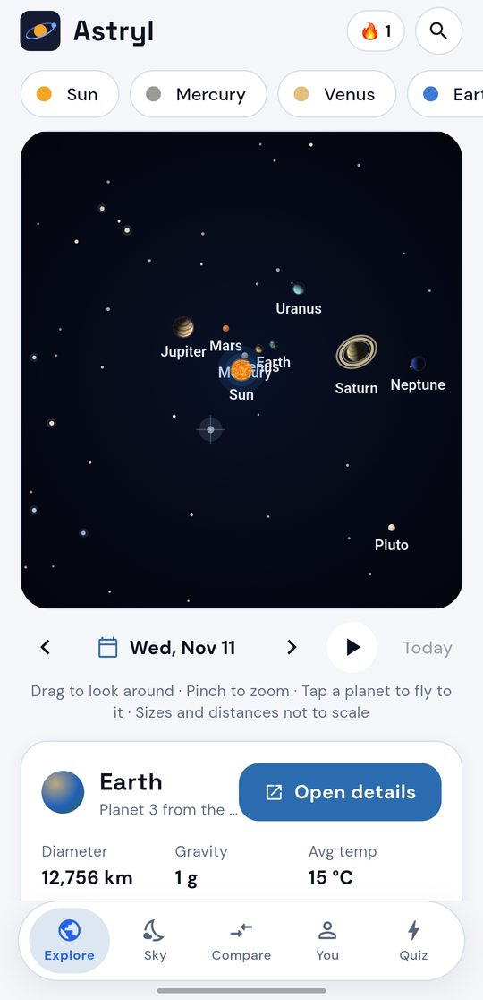
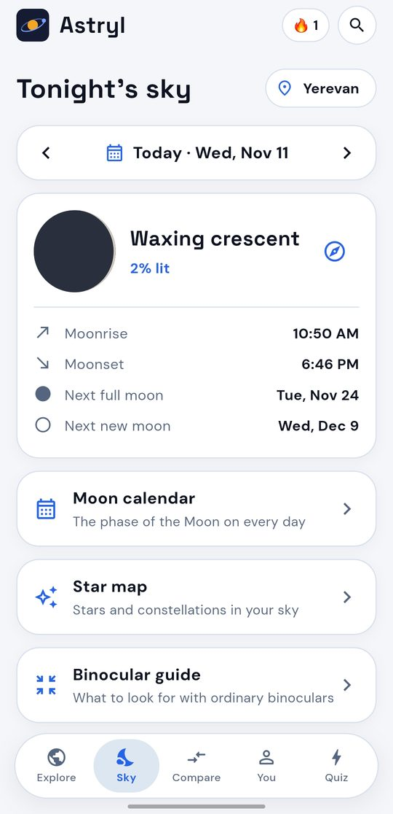
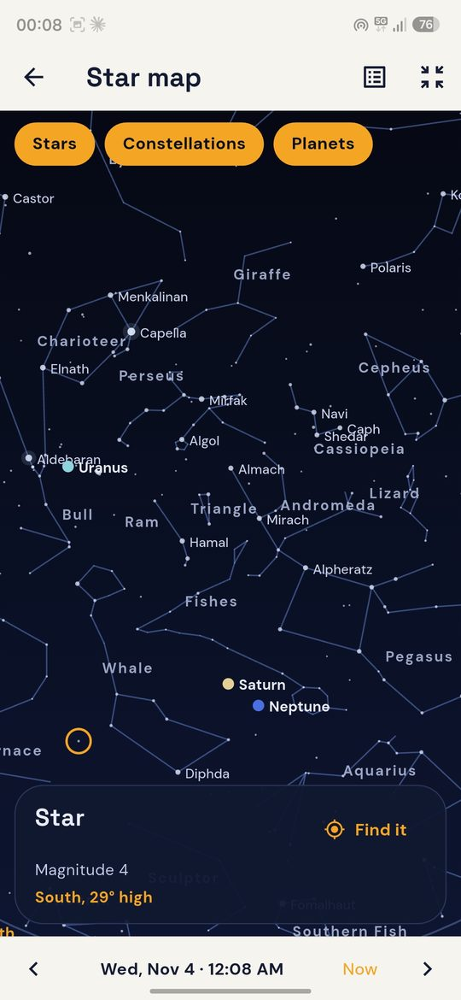
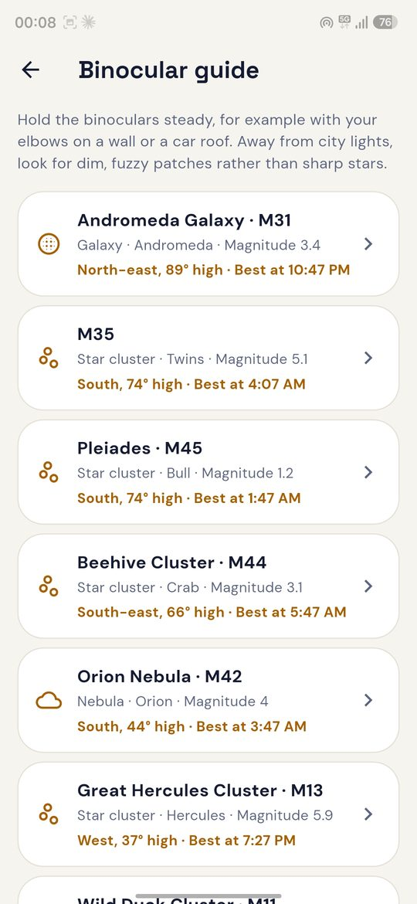
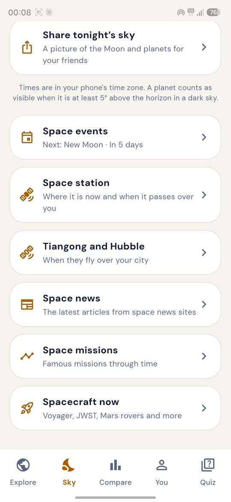
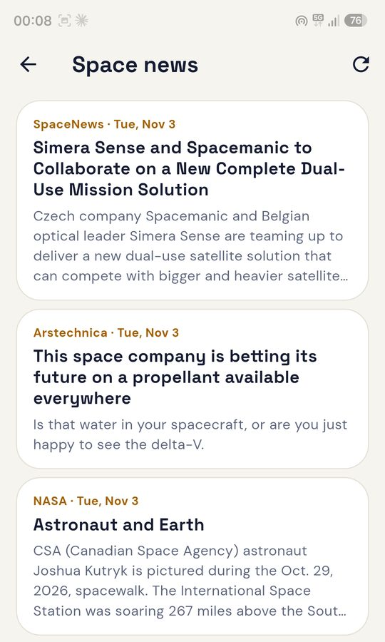
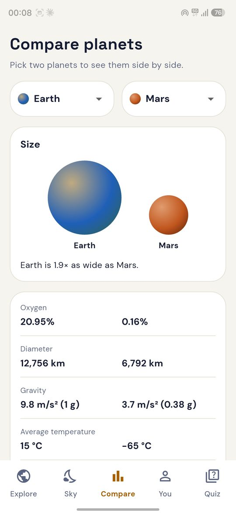
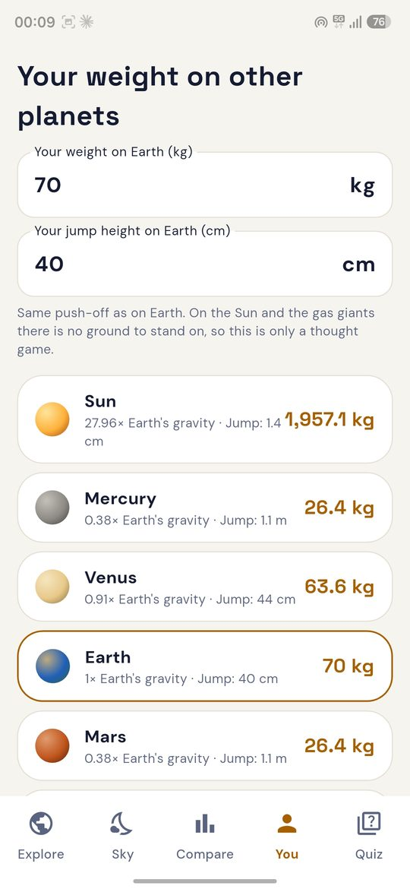

<div align="center">


# Astryl

*Formerly Heliora.*

**Know your space.**

Real planet positions, rotating 3D worlds, a star map for your sky,<br>
and an honest answer to "could humans live here?"

[](https://github.com/aditymishr098-collab/astryl/releases/latest)
[](https://github.com/aditymishr098-collab/astryl/releases)
[](https://astryl.space)
[](LICENSE)


[**⬇ Download the latest APK**](https://github.com/aditymishr098-collab/astryl/releases/latest)

[Website: astryl.space](https://astryl.space) · [Source: github.com/aditymishr098-collab/astryl](https://github.com/aditymishr098-collab/astryl) · [All releases](https://github.com/aditymishr098-collab/astryl/releases) · [Report a problem](https://github.com/aditymishr098-collab/astryl/issues)

</div>

---

## Screenshots

<table>
  <tr>
    <td align="center"><br><sub><b>Explore in 3D</b></sub></td>
    <td align="center"><br><sub><b>Tonight's sky</b></sub></td>
    <td align="center"><br><sub><b>Star map</b></sub></td>
    <td align="center"><br><sub><b>Binocular guide</b></sub></td>
  </tr>
  <tr>
    <td align="center"><br><sub><b>Satellites, news, share</b></sub></td>
    <td align="center"><br><sub><b>Space news</b></sub></td>
    <td align="center"><br><sub><b>Compare worlds</b></sub></td>
    <td align="center"><br><sub><b>Your weight everywhere</b></sub></td>
  </tr>
</table>

## Why Astryl

| | |
|---|---|
| 🔭 **Real sky, real maths** | Planet positions, the Moon, sunrise and sunset, eclipses and the star map are all calculated on your phone, not copied from a website. |
| 🌐 **Always online** | Live data (space station, launches, news), sync and updates need internet. Planet facts and positions are calculated on your phone, and the last data stays on screen without internet. |
| 🔒 **Private** | No ads, no trackers. An account is optional, and the app works fully without one. Nothing is sent unless you agree. |
| 🌍 **English and हिन्दी** | The whole app is in English and Hindi, or follows your phone. |
| 🆓 **Open source** | AGPL-3.0 licence. Read it, change it, build it yourself; if you share a changed version, share its source too. |

## Features

### 🪐 Explore
- **2D map with real positions.** Every planet sits where it really is around the Sun today. Pick any date from 1800 to 2050, step 30 days back or forward, or press play and watch the planets move.
- **3D worlds.** Rotate and zoom every body with your finger: Earth with moving clouds, Jupiter's Great Red Spot, Saturn's rings, the glowing Sun and the cracked ice of Europa.
- **18 worlds.** The Sun, all 8 planets, Pluto, our Moon and 7 famous moons: Io, Europa, Ganymede, Callisto, Titan, Enceladus and Triton.

### 🌙 Tonight's sky
- **Which planets can I see tonight?** Pick your city (no location permission) and Astryl tells you which planets are up after dark, the best time to look, the direction and how high, plus rise and set times.
- **The Moon tonight.** Phase, how much of it is lit, moonrise and moonset, and the dates of the next full and new moon.
- **The sky on any date.** Step a day back or forward, or pick any date from 1900 to 2049. The Moon, the sun times and the planets are worked out for that night. "Back to tonight" brings you home.
- **Moon calendar.** A month of Moon phases, with the dates and times of the new moon, first quarter, full moon and last quarter. Tap a day for its phase, moonrise and moonset, or to see the whole sky on that day.
- **Sun and light.** First light, sunrise, the end of the morning golden hour, solar noon, the start of the evening golden hour, sunset, last light, when the sky is fully dark, and the length of the day.
- **Star map.** The sky above your city with 1,000 stars, 89 constellations, the Moon, the Sun and the planets. Drag to look around, pinch to zoom, tap a star, a planet or a constellation for its name, how bright it is and where it is right now. Switch stars, constellation lines and planets on or off, step the time an hour at a time, or open the full list of constellations.
- **Constellation stories.** Short stories for eleven famous constellations (Orion, the Big Dipper, Polaris, Cassiopeia, Cygnus, Scorpius, Leo, Taurus, Gemini, Lyra and the Southern Cross), with how to find them. Everything is kept in the app, so the star map works offline.
- **Binocular guide.** Twelve sights for ordinary binoculars (the Pleiades, the Orion Nebula, the Andromeda Galaxy and more) with where each one is tonight, how high it gets and when. Tap one to see it on the star map.
- **Space events.** The next 12 months of full and new moons, planet oppositions, the best evenings and mornings to see Mercury and Venus, close meetings of planets, equinoxes and solstices, and the yearly meteor showers (with how bright the Moon will be). Tap the bell on an event and Astryl reminds you the evening before. Reminders are made on your phone and need no internet.
- **Eclipses.** Total, annular, hybrid and partial solar eclipses and total, partial and penumbral lunar eclipses are in the events calendar for the next 12 months, with a bell for each. For your city, Astryl says whether the Moon is up during a lunar eclipse and gives a rough guess of how much of the Sun the Moon covers in a solar eclipse. It is only a guide: check an eclipse map before you travel, and never look at the Sun without eclipse glasses.
- **Tonight in the sky, every evening (optional).** Switch it on in Settings and pick a time. Astryl shows a short note with the Moon's phase and the bright planets you can look for, using your chosen city. It is worked out on your phone. Android lets Astryl prepare about two weeks of notes ahead, so open the app now and then.
- **Space station and rocket launches (needs internet).** Astryl shows where the International Space Station is right now on a map, when it passes over your city (and whether you can see it), and the list of upcoming rocket launches inside the events calendar. All of it has bells for reminders. It is off until you switch it on.
- **Tiangong and Hubble (optional, needs internet).** The same switch shows where China's Tiangong space station and the Hubble Space Telescope are now and when each flies over your city, with a bell for every pass. Hubble is faint, so it is a challenge for a clear night.
- **Space news (optional, needs internet).** The latest space headlines from the [Spaceflight News API](https://spaceflightnewsapi.net) (English, no account or key). Only text is downloaded; a story opens on the publisher's own website.
- **Share tonight's sky.** One tap makes a picture with the Moon and the planets you can see from your city tonight, made on the phone, ready to send to friends.
- **Spacecraft now.** How far Voyager 1, Voyager 2, New Horizons, the James Webb telescope, the space station, Hubble and the Mars rovers are from Earth right now, with how long a radio signal needs to reach them. The far probes are estimates (about 1%), the rest are fixed or calculated for today.
- **Find it with your compass.** Tap the compass button next to the Moon or a planet, hold your phone up, and Astryl shows which way to turn and tilt until you are pointing right at it. It uses your phone's motion sensors only: no camera, no location.

### 🌍 Learn
- **Planet facts.** Diameter, gravity, temperature, length of day and year, known moons, distance from the Sun and surface pressure, in an icon grid that grows with the text size.
- **Atmosphere and oxygen.** What each atmosphere is made of, and how its oxygen compares with Earth's.
- **Could humans live here?** A simple 0 to 10 life score for every world, worked out from temperature, air pressure, oxygen, water, surface and gravity. Earth scores 10, Mars 4, Jupiter 0.
- **How far is it?** Today's real distance from Earth, and how long light, a spacecraft or a car would need to get there.
- **Compare.** Any two worlds side by side, with their true sizes drawn next to each other.

### 🙋 You
- **Your weight and your jump** on every world, from the Moon to the Sun. Type how high you jump on Earth and see how high you would jump on each world.
- **Did you know?** Two short facts about every world, on its page, and a fact of the day on the quiz page. Tap the card for the next one.
- **Your age on other planets** and the date of your next birthday there.
- **My birthday sky.** The Moon's phase and where the planets were on the day you were born, how many days old you are, and the dates of your 10,000th day, your 1 billionth second and other round numbers.
- **Space missions.** A timeline of 15 famous missions from Sputnik 1 to Chandrayaan-3, each with a short story.
- **Surface maps of the Moon and Mars.** Open the Moon or Mars and tap *Surface map*: a flat map with 15 landing sites on the Moon (Luna 9, Apollo 11 to 17, Chang'e 3, 4 and 5, Chandrayaan-3, SLIM and more) and 10 on Mars (Viking, Sojourner, Spirit, Opportunity, Phoenix, Curiosity, InSight, Perseverance, Zhurong). Pinch to zoom, tap a marker for the story, coordinates and who sent it. The map is drawn, not a photo: seas, basins, craters and volcanoes sit in the right places and every site is at its real latitude and longitude.
- **Search and favourites.** Tap the search bar on the home screen to search planets, moons, missions and spacecraft, in your own language or in English. Tap the star on anything to keep it in your favourites, which show when the search box is empty. Starred planets also come first in the row of cards on the home screen.
- **Quiz.** Three levels, 10 questions each: Easy (basics about planets), Medium (planets and moons) and Hard (tricky rankings). Answers are worked out from the data, and your best score for each level is saved.
- **Share.** Turn a planet's card into a picture and send it to your friends.

### ⚙️ Made for everyone
- **Optional account.** Make an account with only a username and a password (no e-mail) and keep a recovery code for a forgotten password. Your favourites, quiz scores, language, theme, city and birth date then follow you between the app and [astryl.space](https://astryl.space). You can skip it, log out, or delete the account and everything stored for it from Settings. See [Privacy](#privacy) and [supabase/README.md](supabase/README.md).
- **Use my location.** In the city list of *Tonight's sky*, one tap uses your approximate location for the sky above you. Android asks first; nothing leaves the phone for this.
- **Backup and restore.** Save your favourites, settings, quiz scores, city and birth date in one small file, send it to yourself, and restore it on another phone. It is made on the phone and goes nowhere unless you send it. Bells for single events are not included, so set them again after restoring.
- **Light, dark or system theme**, and a **text size** setting (Normal, Large, Larger) for easier reading.
- **Two languages:** English and Hindi (हिन्दी), or the language of your phone. Planet and constellation names are translated too. Earlier versions had 20 languages; from 1.16.0 the app is kept in the two that are fully proofread.
- **In-app updates.** New versions download inside the app with a progress bar, then the Android installer opens. Your settings are kept.

## Install

1. Open the [latest release](https://github.com/aditymishr098-collab/astryl/releases/latest) on your Android phone.
2. Download the file `Astryl-vX.Y.Z.apk`.
3. Open it and allow your browser to install apps if Android asks.

If you have a version older than 1.17.5, see the 1.17.5 line in the changelog: the app id changed, so it installs as a new app and you move your data with Backup and Restore.

After that, Astryl updates itself: go to **Settings → Check for updates**, or let it check once a day.

### F-Droid

Astryl is prepared for [F-Droid](https://f-droid.org). That build is made from this source with `--dart-define=FDROID=true`, which removes the in-app updater and the permission to install apps: F-Droid brings the updates. The store texts and screenshots are in `fastlane/metadata/android` and a draft of the F-Droid recipe is in `fdroid/`. F-Droid signs its apps with its own key, so the F-Droid app and the GitHub APK cannot update each other: pick one source.

## Privacy

[Astryl](https://astryl.space): **no ads, and an account only if you want one.** The full policy is at [astryl.space/privacy.html](https://astryl.space/privacy.html).

- Planet data, positions and 3D surfaces are calculated on your phone. Astryl is an online app: it also uses the internet for the update check, crash reports and the live features below. Without internet it shows the last data it has.
- **Live features are always on.** Astryl contacts `api.wheretheiss.at` (or `celestrak.org`) for the station's orbit data, `ll.thespacedevs.com` (Launch Library 2) for the launch list, and `api.spaceflightnewsapi.net` for the news. The orbits of Tiangong and Hubble come from `celestrak.org`. Nothing about you is sent; those services can only see your phone's internet address. The orbit data is saved on the phone, so the station keeps working for days without internet.
- **The account is optional.** If you make one, a small server on [Supabase](https://supabase.com) stores your username, a hash of your password and of your recovery code, the date you accepted the privacy policy, and, if you keep sync on, your favourites, quiz scores, language, theme, city and birth date. Nothing is stored for a visitor who skips it. You can delete the account in Settings → Account and everything is removed.
- **Three more switches, all off until you turn them on:** *count me as an active user* (a random number made on your phone, not linked to you), *share my country* (taken from your phone's language and region setting) and *share my approximate location* (needs an account and Android's location permission; only your latest place is kept, rounded to about 10 km, and it is updated only when you open the app). There is no background location.
- The app can only call one function (`supabase/functions/account`); every table is locked, and the key inside the app is the public (publishable) one. The service key never leaves Supabase.
- Besides that, the internet is used for updates. The app asks GitHub for the latest release and, when you tap **Download and install**, downloads the signed APK from that release. Nothing about you is sent; like any web request, GitHub sees your phone's internet address. Android only installs the APK if it is signed with the same key as the app you already have.
- Your birth date and settings are saved only on your phone. Android's cloud backup is switched off for Astryl; the backup file in Settings is made only when you ask and goes only where you send it.
- **Update check:** each time the app opens, it asks GitHub for the newest release and offers it first, with **Update now** and **Skip**.
- **Crash reports (on by default, switch in Settings → Send crash reports):** if the app crashes, one small report (the error text, the technical trace, the app version, the Android version string and the app language) is sent to the project's own Supabase (`crashes` table, kept 90 days, only used to fix bugs). It has no name, account, device id or location.

## How it works

| Part | How |
|---|---|
| Quiz and facts | Most answers are worked out from the same data as the planet pages, so they stay right when the data changes. A few (the moon with water geysers, the most volcanic moon, the moon that orbits backwards) are well known facts about one world. The "Did you know?" facts are written by hand from NASA sources. |
| Eclipses | The Moon's position (Schlyter's method plus its distance) and the Sun's position decide when the Moon passes in front of the Sun or into Earth's shadow. Compared with the official eclipse lists for 2022 to 2029: all the main eclipses are found with the right type, times within a few minutes. Very faint penumbral eclipses are left out. The local estimate for a solar eclipse is rough (about 6% of the Sun's width). |
| Spacecraft distances | Voyager 1 and 2 are placed from NASA's one-light-day dates (173.14 AU, 18 Nov 2026 and Nov 2035) and New Horizons from its 50 AU date (17 Apr 2021), then moved at their average speeds in a straight line. That is good to about 1%; the true distance from Earth wobbles by up to 1 AU over a year as Earth moves. The Mars rovers use the same orbit maths as the planet pages. The space station, Hubble and JWST use fixed typical values. |
| Tonight alerts | Astryl sets up to 15 Android alarms ahead, one per evening, each with text worked out on the phone. They are set again each time the app is opened and after a restart or update. |
| Planet facts | [NASA Planetary Fact Sheet](https://nssdc.gsfc.nasa.gov/planetary/factsheet/). Moon counts are NASA's known moons as of mid 2026. |
| Real positions and distances | Keplerian orbital elements from JPL ([Standish](https://ssd.jpl.nasa.gov/planets/approx_pos.html)), valid 1800–2050, solved on the phone. Checked against the 2025 Mars and Saturn and the 2026 Jupiter oppositions. |
| 3D globes | A single fragment shader (`shaders/planet.frag`) draws every surface from noise, so the app ships with no image files. |
| Tonight's sky | Rise, set and best viewing time from the same orbits plus the Moon from Paul Schlyter's method, all on the phone. Checked against London's sunrise on 21 June 2025 and the full and new moons of October 2025 and January 2026. |
| Sun and light | The Sun's height in the sky is calculated every 2 minutes over the solar day of your city, and each time it crosses a level is found by interpolation: -0.833° for sunrise and sunset, 6° for the golden hours, -6° for first and last light, -18° for the fully dark sky. Solar noon is the top of the curve. Checked against London's shortest day and against the older sunrise code. Good to about 3 minutes. |
| Moon calendar | The Moon's phase on each day is taken at noon. The four main phases are found by searching for the moment the Sun to Moon angle reaches 0, 90, 180 or 270 degrees, good to about an hour. |
| Space events | The same orbits and Moon maths find each event on the phone: oppositions where a planet is opposite the Sun in longitude, greatest elongations, planet pairs closer than 2°, and equinoxes and solstices. Checked against 2025–2026: Mars (16 Jan 2025), Saturn (21 Sep 2025) and Jupiter (10 Jan 2026) oppositions, Venus at 47° on 10 Jan 2025 and 15 Aug 2026, and the 2026 equinoxes and solstices within 15 minutes. Meteor shower peaks are typical yearly dates. |
| Space station | The station's orbit data (a TLE) is downloaded once and the position is computed on the phone with SGP4 (`lib/core/sgp4.dart`), checked against Vallado's published test vectors. A pass counts as easy to see when the Sun is more than 6° below the horizon and the station is still lit by the Sun. |
| Tiangong and Hubble | The orbit of each one (a TLE from CelesTrak, kept on the phone) is checked to carry the right catalogue number, then used with the same SGP4 code and pass finder as the space station. Hubble is only about magnitude 2 to 3 at its best, so it is hard to see. |
| Rocket launches | The list comes from [Launch Library 2](https://thespacedevs.com/llapi). Times are "no earlier than" and change often, so the list is refreshed at most every 3 hours. |
| Star map | About 1,000 stars (down to magnitude 4.6), the constellation lines and 12 binocular targets come from the [d3-celestial](https://github.com/ofrohn/d3-celestial) data (Hipparcos-based, BSD 3-clause, see `assets/licenses`) and are stored in `lib/data/sky_catalog.dart`. Positions are for the year 2000, so Astryl turns them to today's equinox with the IAU 1976 precession (up to about 0.4° by now, 0.28° for Sirius) before drawing them together with the Sun, Moon and planets. The sky is drawn with a stereographic projection. Checked on the phone-independent maths: Polaris stands at your latitude (within 1°), and Sirius reaches 33.1° from Yerevan. Stars fainter than magnitude 4.6 are not shown, so very dark skies will show more than the map. Names of stars and binocular objects stay in English, constellation names are translated into Hindi. |
| Compass finder | The phone's rotation sensor gives where the back of the phone points; Android's magnetic-declination model turns magnetic north into true north. The target comes from the same orbit maths as Tonight's sky. |
| Life score | Six simple rules in `lib/core/habitability.dart`. A teaching aid, not science. |

## Build from source

```
flutter pub get
flutter gen-l10n
flutter analyze
flutter test
flutter build apk --release
```

Releases are built and signed by GitHub Actions when a version tag such as `v1.4.0` is pushed (see `.github/workflows/release.yml`). Every push to `main` is checked by `.github/workflows/ci.yml`.

## Roadmap

| Version | Plan |
|---|---|
| 1.12.0 | New look: search bar on the home screen, tinted planet cards with starred ones first, icon stats on the planet page |
| 1.13.0 | Moon calendar, the sky on any date, sunrise, sunset and golden hour (done) |
| 1.14.0 | New design: Space Grotesk and DM Sans fonts, big planet cards, a scrolling Explore page, a new planet page and bottom bar (done) |
| 1.15.0 | Constellations and bright stars (kept in the app, offline), a star map you drag with your finger, constellation stories, binocular guide (done) |
| 1.16.0 | Optional online features: space news, Tiangong and Hubble passes, a share card for tonight's sky; the app is kept in English and Hindi (done) |
| 1.17.0 | Smoother animations and less battery use, backup and restore (done) |
| 1.18.0 | Optional account, sync with the website, privacy policy (done) |
| 1.19.0 | Update offered first on every start (with Skip), crash reports to the project's Supabase, new tagline "Know your space", a turning Milky Way on the website (done) |
| 1.19.1 | Always online, account settings in the You tab (done) |
| 1.19.2 | All settings inside the You tab, soft animations (done) |
| 1.19.3 | More compact Home (done) |
| 1.19.0 | The big moons of Jupiter and Saturn, with their real positions |
| 1.21.0 | Larger layout for tablets |
| 2.0.0 | All the planets in one 3D scene you can fly around |

Plans can change. An account stays optional, and nothing is collected unless you agree to it.

## Fonts

Titles use [Space Grotesk](https://fonts.google.com/specimen/Space+Grotesk) and the rest of the text uses [DM Sans](https://fonts.google.com/specimen/DM+Sans). Both are licensed under the SIL Open Font License (see `assets/fonts/OFL-*.txt`) and are kept inside the app, so nothing is downloaded. Devanagari (Hindi) uses the phone's own font.

## Star data

Stars, constellation lines, names and the Messier objects come from [d3-celestial](https://github.com/ofrohn/d3-celestial) by Olaf Frohn (BSD 3-clause licence, copy in `assets/licenses/d3-celestial-LICENSE.txt`), which is built on the Hipparcos catalogue.

## Translations

All texts live in `lib/l10n/app_en.arb` and `lib/l10n/app_hi.arb`. Found a wrong word? Edit the matching file and open a pull request. Help from native speakers is very welcome.

## Changelog

| Version | What's new |
|---|---|
| **1.18.0** | Optional online account (username and password, no e-mail) with a recovery code for a forgotten password, a "Skip now" choice and a privacy-policy tick box. Your favourites, quiz scores, language, theme, city and birth date sync with astryl.space. Settings → Account has switches for sync, the anonymous active-user count, country and approximate location, a new recovery code, log out and delete account. "Use my location" in the city list. New privacy policy on the website. Backend in `supabase/`. Your data and settings are kept |
| **1.19.0** | Each time the app opens it asks GitHub for a newer version and offers it first, with **Update now** and **Skip**; the "Check for updates" button is gone. Crash reports (error text, app and Android version, language; no personal data) go to the project's own Supabase, with a switch in Settings and a line in the Privacy Policy. New tagline "Know your space". The website has a turning Milky Way and a scroll journey to the Solar System and the Moon. |
| **1.19.1** | Astryl is always online now: the *Online features* switch is gone and the space station, launches and news are always on. The Account card and the crash-report switch moved from Settings to the **You** tab. |
| **1.19.2** | The Settings screen is gone: everything moved into the **You** tab (Account, weight and age, then Appearance, Language, Daily sky note, Backup, About) and the gear button was removed. New *Report a bug* link. Soft fade-and-slide animations on the You tab and the start screen (off when the phone's "remove animations" is on). |
| **1.19.3** | Home is more compact: smaller names and headings, shorter planet cards with the text right under the planet, and in the 3D view the details (oxygen, temperature, life score) now sit above the globe. |
| **1.17.6** | Surface maps for the Moon and Mars with 25 landing sites. Open the Moon or Mars and tap Surface map. Your data and settings are kept |
| **1.17.5** | New app id `space.astryl.app` (it was `online.lumioapps.heliora`), after the website astryl.space. Android sees this as a **new app**, so it installs next to the old one instead of updating it. To move over: in the old app open Settings → Backup → Save, install 1.17.5, open Settings → Backup → Restore in the new app, then uninstall the old one. Reminders for single events are not kept, set them again |
| **1.17.4** | The licence is now AGPL-3.0 (versions up to 1.17.3 stay under MIT). The name "Lumio Apps" is gone from the project texts; the copyright line is now Astryl and astryl.space. Settings → About has a new link to the website. Your data and settings are kept |
| **1.17.3** | The app is now called **Astryl** (it was Heliora). New name on the home screen, in the update dialog, in shared texts and in file names; the repository is now github.com/aditymishr098-collab/astryl and the website is astryl.space. It installs over Heliora as an update: your data, settings and old backups are kept |
| **1.17.2** | The project moved to an organisation account (github.com/lumio-apps/heliora). The update check, share texts and links point to it. Nothing else changes; your data and settings are kept |
| **1.17.1** | Safer updates and storage: every address on the way to an update must be GitHub (redirects are checked one by one), Android's cloud backup and plain-http traffic are switched off, and the boot receiver ignores any other broadcast. README privacy text made more exact. Your data is kept |
| **1.17.0** | Backup and restore (one small file with favourites, settings, quiz scores, city and birth date). Lighter on the battery: hidden tabs no longer animate, the 3D planet and the 2D play mode run at 30 frames a second when idle, the planet stands still when the phone asks for reduced motion, and the star map keeps its text layouts between frames |
| **1.16.2** | The project moved to a personal GitHub account (github.com/aditymishr098-collab/heliora). The update check, share texts and links now point to the new address. Nothing else changes; your data and settings are kept |
| **1.16.1** | Ready for F-Droid: store texts in English and Hindi, screenshots, and a build flag (`FDROID`) that turns the in-app updater off for that build. Nothing changes in the normal build |
| **1.16.0** | Space news, Tiangong and Hubble passes with reminders, and a share card for tonight's sky (all online parts are off until you switch them on; the share card works offline). The app is now in English and Hindi only: the other 18 languages are removed. Your saved settings are kept; a removed language falls back to the phone's |
| **1.15.0** | Star map with about 1,000 stars, 89 constellations, the Moon and planets (drag, pinch, tap), stories for 11 constellations, a binocular guide with where to look tonight, and the time of the sky in steps of one hour. 29 new texts in 20 languages |
| **1.14.0** | New design: Space Grotesk and DM Sans fonts (bundled, no download), big glowing planet cards, an Explore page that scrolls with the Solar System in its own card, a new planet page with a centred planet, life-score badge and a three-column stats card, round buttons, bordered cards and a flatter bottom bar |
| **1.13.0** | Moon calendar, the sky on any date (1900 to 2049), and a Sun and light card with golden hour, twilight and the dark-sky window. The Sky tab now starts with the Moon and the planets, with the other cards below |
| **1.12.0** | New look: search bar on the home screen, tinted planet cards (starred ones first), icon stats on the planet page that grow with the text size |
| **1.11.0** | Spacecraft now (Voyager, New Horizons, JWST, ISS, Hubble, Mars rovers), search and favourites, and a text size setting |
| **1.10.0** | Eclipse calendar (solar and lunar) with reminders and a rough local guide, a daily "tonight in the sky" notification, "My birthday sky" and a timeline of 15 space missions |
| **1.9.0** | Quiz with Easy, Medium and Hard levels (now with moon questions), "Did you know?" facts for every world in 20 languages, jump height on every world |
| **1.8.0** | Online features (off by default): live International Space Station map and passes over your city, upcoming rocket launches in the events calendar, reminders for both |
| **1.7.0** | Space events calendar for the next 12 months with reminders: Moon phases, oppositions, planet meetings, equinoxes, solstices and meteor showers |
| **1.6.0** | Find the Moon and planets in the real sky with your phone's compass: turn and tilt guidance, 20 languages |
| **1.5.0** | New Sky tab: planets visible tonight from your city, Moon phase, moonrise, next full and new moon, sunset and sunrise |
| **1.4.0** | Distance from Earth today with travel times, true-scale size compare, share a planet card as a picture |
| **1.3.0** | Real planet positions for any date (1800–2050) with play, your age on other planets |
| **1.2.0** | Updates download and install inside the app |
| **1.1.0** | The Sun, Pluto, the Moon and 7 major moons, "Could humans live here?" life score |
| **1.0.0** | First release: 2D and 3D views, planet facts, atmosphere and oxygen, compare, weight, quiz, 20 languages |

## Links

- Website: [astryl.space](https://astryl.space)
- Website source: the folder `site/`, built from the app's own data by `python3 tools/build_site.py` and published by GitHub Pages (`.github/workflows/pages.yml`)
- Source code: [github.com/aditymishr098-collab/astryl](https://github.com/aditymishr098-collab/astryl)
- Downloads: [latest release](https://github.com/aditymishr098-collab/astryl/releases/latest)
- Bugs and ideas: [issues](https://github.com/aditymishr098-collab/astryl/issues)

## License

[AGPL-3.0](LICENSE) © 2026 Astryl · [astryl.space](https://astryl.space)

Versions up to 1.17.3 were released under the MIT licence and stay under it. From 1.17.4 the code is under the GNU Affero General Public License v3.0: you may use, study, change and share it, and if you share a changed version (or run one as a service for others) you must share its source under the same licence.
