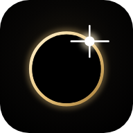

<div align="center">



# Astryl

### Know your space.

**[astryl.space](https://astryl.space)** is a free, open-source website about space: planets and moons with real numbers, the sky for your own city tonight, stars, black holes and galaxies, a live map of where the spacecraft are, quizzes, a community and a blog.

[](LICENSE)
[](https://astryl.space)


[**🌐 Open astryl.space**](https://astryl.space) · [**📝 Blog**](https://astryl.space/blog.html) · [**👥 Community**](https://astryl.space/community.html)

</div>

---

## Why Astryl

| | |
|---|---|
| 🔭 **Real sky, real maths** | Planet positions, the Moon, sunrise and sunset, eclipses and the star map are calculated in your browser for any date, not copied from somewhere else. |
| 🌱 **Something new every day** | *Discover today* on the home page: this day in space history, a world and a word of the day, the Daily 5 quiz and a count of your days in a row. |
| 🔒 **Private** | No ads, no trackers, no cookies. An account is optional and is only a username and a password, no e-mail. |
| 📖 **Open** | All the code, the data and the server functions are in this repository. |

## What is on the website

**The Solar System**
- **Planets and moons.** Every planet, Pluto, the Sun and the big moons: size, gravity, temperature, day and year, how each one formed, real photos.
- **Solar System 3D Live.** The planets where they really are, for any date.
- **Compare** any two worlds, and **You in space**: your weight, your jump and your age on each one.
- **Moon and Mars maps** with the landing site of every mission.

**The sky from your city**
- **Moon and sky tonight.** Moon phase and calendar, rise and set times, which planets are up.
- **Constellations.** All 88, drawn true to the sky.
- **Eclipses and meteor showers.** Every eclipse until 2029 with times for your city.
- **Space station passes** with a live map, and a **telescope simulator**.

**Deep space**
- **Stars**: how they are born, live and die, with an interactive life cycle.
- **Black holes**: seven lessons, a lab to play with gravity and light, and Black holes 101.
- **Galaxies**, a **3D universe map** of 3,600 real galaxies, the **scale of the universe** and a **timeline** of 13.8 billion years.

**Missions and spacecraft**
- **Space missions** from Sputnik to Chandrayaan-3.
- **Spacecraft now.** A turning map of the Solar System showing where Voyager 1 and 2, New Horizons, James Webb and others are today, with distances as light travel time and a date slider.

**Play, share and read**
- **Quiz.** Daily 5 (the same five questions for everybody each day), ranked rounds, Space Points, badges and leaderboards. Answers are checked on the server.
- **Astryl Community.** Share your own photos of the sky, ask questions and answer others. Edit, delete and report from the ⋯ menu.
- **Blog** with comments that need no account.
- **Account and profile.** Optional; keeps favourites, scores and settings on every device. Change your username, or delete everything with one button.
- **For students**: lessons for class 6 to 10, and a **glossary**.

The website can be installed on a phone or computer and works offline for the pages you have opened.

## Privacy and security

- No ads, no third-party analytics, no cookies. Page views are only added up, with no IP address or id kept.
- Every database table has row-level security on and no public policy; only the server functions in `supabase/functions/` can read or write them, and they check each person's own login token.
- No secret is stored in this repository. The website contains only Supabase's public (publishable) key.
- Details: [Privacy Policy](https://astryl.space/privacy.html), [Your data](https://astryl.space/your-data.html), [Terms and Conditions](https://astryl.space/terms.html) and [SECURITY.md](SECURITY.md).

## How it is built

Astryl is a static website. A Python script turns the data in `data/` into the pages in `site/`, and GitHub Pages serves that folder. Accounts, quizzes, the community and comments use a small Supabase backend.

```
data/                everything the build reads: tables, texts, photos, textures, fonts, cities
tools/build_site.py  builds the whole site
tools/*.py           one module per section (stars, galaxies, blog, legal pages, ...)
tools/site_src/      the site's JavaScript and CSS
site/                the built website (what astryl.space serves)
supabase/            server functions and database migrations
```

### Build it yourself

```bash
pip install pillow numpy fonttools==4.66.1
python3 tools/build_site.py
python3 -m http.server 8000 -d site    # then open http://localhost:8000
```

### Workflows

| Workflow | What it does |
|---|---|
| `site-check.yml` | Builds the site on every pull request, so a broken build never reaches `main`. |
| `pages.yml` | Publishes `site/` to astryl.space when `main` changes. |
| `backup.yml` | Makes an encrypted backup of the database every night (see [docs/BACKUP.md](docs/BACKUP.md)). |
| `keepalive.yml` | Keeps the free Supabase project awake. |

## How the numbers are made

| What | How |
|---|---|
| Positions of the planets | Keplerian orbital elements from [JPL](https://ssd.jpl.nasa.gov/planets/approx_pos.html), solved in the browser for the chosen date. |
| The Moon and the Sun | Paul Schlyter's method; phases, rise and set times for your city. |
| Moons of Jupiter and Saturn | Jean Meeus, *Astronomical Algorithms*. |
| The space station | SGP4 (David Vallado) with orbit data from CelesTrak. |
| Far spacecraft on the map | Published distance and speed, placed along the direction each probe is heading. This is an estimate, and the page says so. |
| Universe map | Galaxies from OpenNGC, with measured distances for nearby galaxies and estimates from redshift for the rest. |

## Credits

- Planet facts: [NASA](https://nssdc.gsfc.nasa.gov/planetary/factsheet/). Orbits: [JPL](https://ssd.jpl.nasa.gov/planets/approx_pos.html). Moons of Jupiter and Saturn: Jean Meeus, *Astronomical Algorithms*, checked against the MIT-licensed [astronomia](https://github.com/commenthol/astronomia) library.
- Stars, constellation lines and the Messier objects: [d3-celestial](https://github.com/ofrohn/d3-celestial) by Olaf Frohn (BSD 3-clause, copy in `data/licenses`), built on the Hipparcos catalogue.
- World cities: [GeoNames](https://www.geonames.org/) via [lutangar/cities.json](https://github.com/lutangar/cities.json) (CC BY 4.0).
- Galaxies on the Universe map: [OpenNGC](https://github.com/mattiaverga/OpenNGC) by Mattia Verga and contributors (CC BY-SA 4.0). The data file `data/tables/universe_catalog.dart` is shared under the same CC BY-SA 4.0 licence.
- Photos: NASA, ESA, ISRO and others, with the credit and licence under every picture. Surface maps: Solar System Scope (CC BY 4.0).
- Live data: [Where the ISS at?](https://wheretheiss.at), [CelesTrak](https://celestrak.org) and NASA's Astronomy Picture of the Day.
- Fonts: [Space Grotesk](https://fonts.google.com/specimen/Space+Grotesk) and [DM Sans](https://fonts.google.com/specimen/DM+Sans), both under the SIL Open Font License (`data/fonts/OFL-*.txt`).

## Contributing

Bugs and ideas are welcome in the [issues](https://github.com/aditymishr098-collab/astryl/issues). Found a wrong number or a wrong word? Open a pull request; the build check runs by itself. For security problems, see [SECURITY.md](SECURITY.md).

## License

[AGPL-3.0](LICENSE) © 2026 Astryl · [astryl.space](https://astryl.space)

You may use, study, change and share the code, and if you share a changed version (or run one as a service for others) you must share its source under the same licence.
